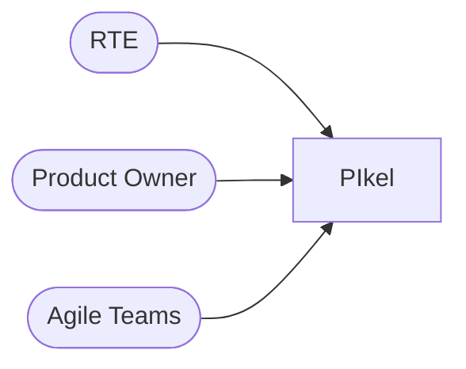
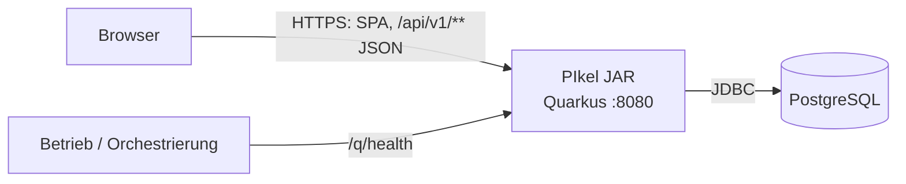
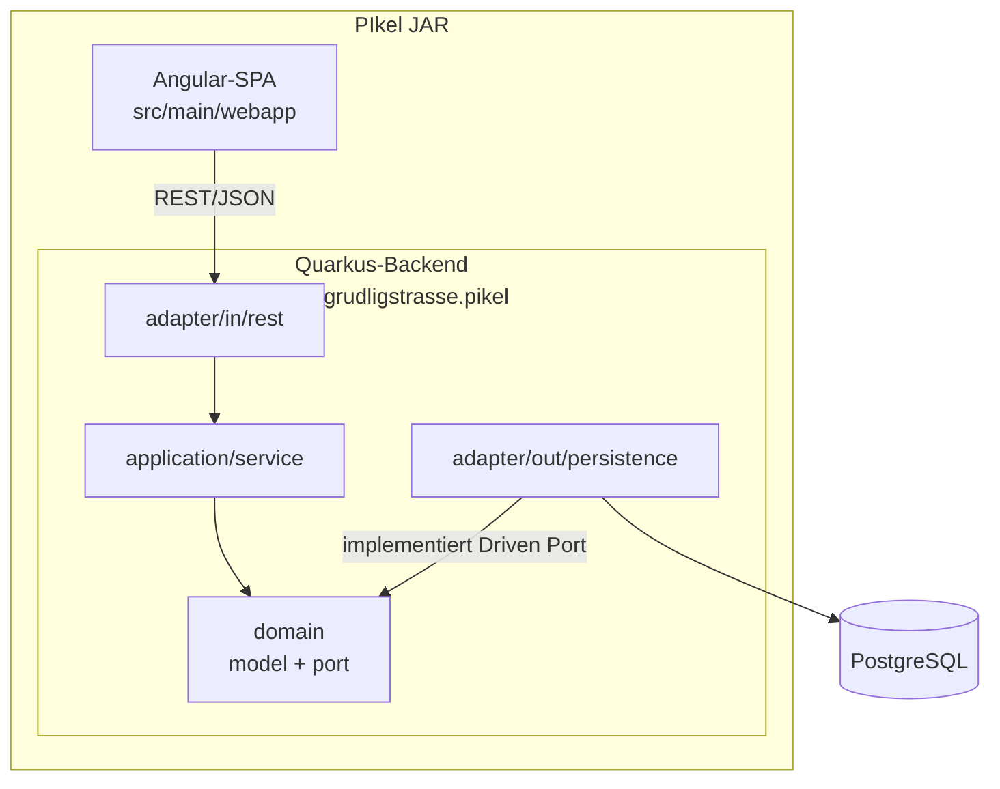
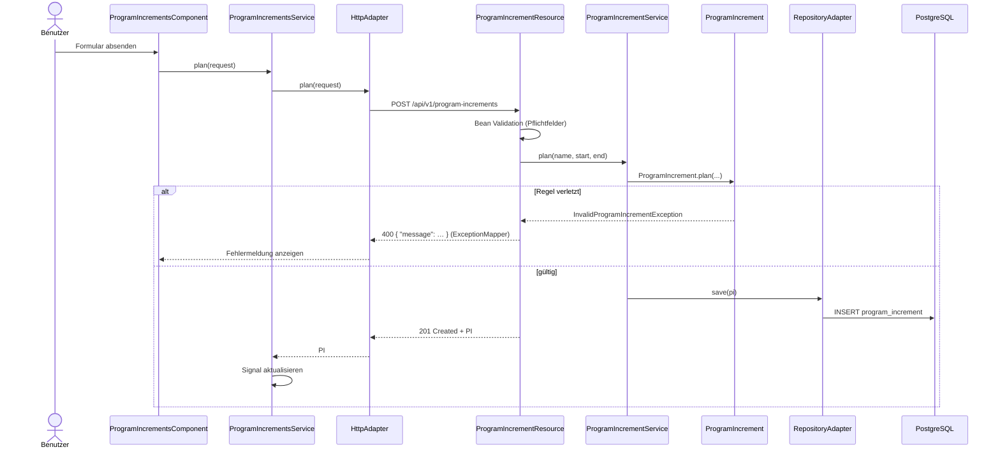
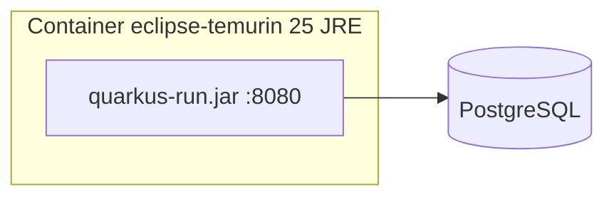

# Architekturdokumentation PIkel (arc42)

**Stand:** 2026-11-07 · Walking Skeleton (US-1)

Gliederung nach [arc42](https://arc42.org). Was schon an einem anderen Ort steht, wird hier verlinkt statt kopiert —
jede Regel hat genau einen Ort:

| Thema | Ort |
|-------|-----|
| Fachbegriffe, Datenmodell, REST-API | [`spec/fachliche-spezifikation.md`](../spec/fachliche-spezifikation.md) |
| Konfiguration, Persistenz, Betrieb | [`spec/technische-spezifikation.md`](../spec/technische-spezifikation.md) |
| Schichten, Testpyramide, Code-Regeln | [`CLAUDE.md`](../CLAUDE.md), [`.claude/rules/`](../.claude/rules/) |
| Entscheide | [`docs/adr/`](adr/) |
| Ablauf, Build, Definition of Done | [`.claude/flow.md`](../.claude/flow.md) |

## 1. Einführung und Ziele

### Aufgabenstellung

PIkel unterstützt das **PI Planning** nach SAFe: Ein Agile Release Train (ART) plant für ein Program Increment (PI)
Features, verteilt sie auf Teams und Iterationen, macht Abhängigkeiten sichtbar und hält PI Objectives fest.

Heute umgesetzt ist ein Durchstich durch alle Schichten: **Program Increment anlegen und auflisten**
([US-1](../spec/user-stories/1-pi-anlegen.md)). Die fachliche Breite kommt Story für Story.

### Qualitätsziele

| Prio | Qualitätsziel | Bedeutung für PIkel |
|------|---------------|---------------------|
| 1 | Änderbarkeit | Neue Fachlichkeit kommt Story für Story dazu, ohne bestehende Schichten umzubauen |
| 2 | Testbarkeit | Fachlogik ohne Quarkus und ohne Datenbank testbar; jede Regel durch einen Test belegt |
| 3 | Korrektheit | Fachliche Regeln (z. B. Enddatum nach Startdatum) gelten an genau einem Ort |
| 4 | Bedienbarkeit | Oberfläche Deutsch (Schweiz), Du-Form, verständliche Fehlermeldungen |
| 5 | Betreibbarkeit | Ein deploybares JAR bzw. Container, Health-Checks, Schema-Migration beim Start |

### Stakeholder

| Rolle | Erwartung |
|-------|-----------|
| Release Train Engineer (RTE) | PI anlegen, Planung moderieren, Überblick über den ART |
| Product Owner / Product Management | Features ins PI bringen, Business Value bewerten |
| Agile Teams | Features auf Iterationen planen, Abhängigkeiten und PI Objectives erfassen |
| Entwicklung (Lukas, Claude Code) | Klare Schichten, schneller Test-Loop, Regeln, die der Build prüft |

## 2. Randbedingungen

### Technisch

| Randbedingung | Erläuterung |
|---------------|-------------|
| Java 25, Quarkus 3.40 | Backend, Hibernate ORM mit Panache |
| Angular 22, TypeScript 6, Tailwind CSS 4 | Standalone, Signals, zoneless |
| PostgreSQL, Liquibase | Schema nur über neue Migrationen; Hibernate validiert nur |
| Ein Maven-Modul | Backend und SPA über Quinoa in einem JAR |
| Podman oder Docker | Dev Services starten PostgreSQL für Dev und Tests |

### Organisatorisch

| Randbedingung | Erläuterung |
|---------------|-------------|
| Spezifikation zuerst | Gherkin unter `src/test/resources/features/` ist die Spezifikation; Tests vor dem Code |
| Arbeitsablauf | `/flow-task` → `/flow-plan` → `/flow-implement` → `/flow-ship`, Issues und PRs auf GitHub |
| Qualitäts-Gate | `scripts/gate.sh` muss vor jedem Push grün sein (dieselben Prüfungen wie CI) |
| Sprache | Oberfläche Deutsch mit Schweizer Schreibweise, Bezeichner Englisch, SAFe-Begriffe englisch |

## 3. Kontextabgrenzung

### Fachlicher Kontext

| Nachbar | Austausch |
|---------|-----------|
| RTE, Product Owner, Teams | Program Increments (heute), später Teams, Iterationen, Features, Abhängigkeiten, PI Objectives |

Umsysteme (Issue-Tracker wie Jira, Identity Provider) sind noch nicht angebunden. Die Anmeldung über OIDC ist als
eigene Story geplant (Abschnitt 11).

### Technischer Kontext

| Schnittstelle | Technik | Beschreibung |
|---------------|---------|--------------|
| Benutzeroberfläche | HTTP, statische Dateien | Angular-SPA, ausgeliefert von Quarkus (Quinoa, SPA-Routing) |
| REST-API | HTTP, JSON unter `/api/v1/**` | Verträge in der fachlichen Spezifikation, OpenAPI unter `/q/openapi` |
| Datenbank | JDBC | PostgreSQL, Zugang über `QUARKUS_DATASOURCE_*` |
| Health | HTTP | `/q/health/live`, `/q/health/ready` |

## 4. Lösungsstrategie

| Ziel | Ansatz |
|------|--------|
| Änderbarkeit, Testbarkeit | Hexagonale Architektur in Backend **und** Frontend; `domain/` ist framework-frei |
| Korrektheit | Fachregeln im Compact Constructor der Domain-Records; REST validiert nur Form (fail fast an der Grenze) |
| Schneller Start der Fachlichkeit | Walking Skeleton mit dem Stack von Brainy ([ADR 0001](adr/0001-walking-skeleton.md)) |
| Testbarkeit | Testpyramide mit Unit als Default, Mutationstests (PIT ≥ 80 %), Gherkin als Spezifikation |
| Betreibbarkeit | Ein JAR, Liquibase `migrate-at-start`, Hibernate `validate`, Health-Checks |
| Einhaltung der Regeln | Regeln, die der Build prüft: ArchUnit, Spotless/Prettier, Spec-Drift-Gate in CI |

## 5. Bausteinsicht

### Ebene 1

Abhängigkeiten zeigen nur nach innen; `ArchitectureTest` (ArchUnit) bricht den Build bei einem Verstoss.

| Baustein | Verantwortung | Inhalt heute |
|----------|---------------|--------------|
| `domain/model` | Fachobjekte und -regeln, ohne Framework | `ProgramIncrement`, `InvalidProgramIncrementException` |
| `domain/port/in` | Driving Ports (Use Cases) | `ProgramIncrementUseCase` |
| `domain/port/out` | Driven Ports (Repositories) | `ProgramIncrementRepository` |
| `application/service` | Implementiert Use Cases, Transaktionsgrenze | `ProgramIncrementService` |
| `adapter/in/rest` | HTTP ↔ Use Case, DTOs, Exception-Mapping | `ProgramIncrementResource`, `InvalidProgramIncrementExceptionMapper` |
| `adapter/out/persistence` | JPA-Entities, Mapping Entity ↔ Domain | `ProgramIncrementEntity`, `ProgramIncrementRepositoryAdapter` |
| Angular-SPA | Oberfläche, eigenes Hexagon | siehe Ebene 2 |

### Ebene 2: Angular-SPA

| Baustein | Verantwortung | Inhalt heute |
|----------|---------------|--------------|
| `core/models` | Domain-Typen | `program-increment.model.ts` |
| `core/ports` | Abstrakte Repositories (Driven Ports) | `program-increments.repository.ts` |
| `core/api` | HTTP-Adapter, einziger Ort für `HttpClient` | `program-increments-http.adapter.ts` |
| `core/services` | Use Cases, State als Signals | `program-increments.service.ts` |
| `features/` | UI pro Route (Driving Adapter) | `program-increments` |
| `shared/` | Wiederverwendbare UI ohne Fachlogik | — |

Port und Adapter werden in `app.config.ts` verdrahtet; Tests ersetzen den Port durch ein Mock-Objekt.

## 6. Laufzeitsicht

### PI anlegen

### Anwendungsstart

1. Quarkus startet, Liquibase führt ausstehende Migrationen aus (`db/changeLog.xml`)
2. Hibernate prüft das Schema gegen die Entities (`validate`) — eine Abweichung verhindert den Start
3. `/q/health/ready` meldet bereit; Quinoa liefert die SPA aus, unbekannte Pfade fallen auf `index.html` zurück

## 7. Verteilungssicht

| Umgebung | Datenbank | Start |
|----------|-----------|-------|
| Entwicklung | Dev Services (`postgres:17` per Podman/Docker) | `./mvnw quarkus:dev`, Angular-Dev-Server auf :4200 hinter Quarkus |
| Test / CI | Dev Services | `./mvnw verify` bzw. GitHub Actions (`ci-pr.yml`, `ci-main.yml`) |
| Produktion | externe PostgreSQL über `QUARKUS_DATASOURCE_*` | `java -jar` oder Container aus `src/main/docker/Dockerfile.jvm` |

Ein Deployment-Ziel ist noch nicht festgelegt (Abschnitt 11).

## 8. Querschnittliche Konzepte

### Domänenmodell und Validierung

Domain-Objekte sind Java-Records; fachliche Regeln stehen im Compact Constructor und werfen fachliche Exceptions.
Die REST-Schicht prüft nur die Form (Bean Validation: Pflichtfelder); ein `ExceptionMapper` übersetzt fachliche
Exceptions in HTTP 400 mit `{ "message": … }`. Die Datenbank sichert zusätzlich mit Constraints ab
(`NOT NULL`, `CHECK (end_date > start_date)`).

### Persistenz

JPA-Entities leben nur in `adapter/out/persistence`, das Mapping Entity ↔ Domain im Adapter. Das Schema ändert sich
nur über eine **neue** Liquibase-Migration; bestehende Migrationen werden nie geändert (Checksummen).

### Transaktionen

Die Transaktionsgrenze liegt im Application Service (`@Transactional`), nicht in Resource oder Adapter.

### Fehlerbehandlung

Keine `null`-Rückgaben (`Optional` bzw. `undefined`). Fachliche Fehler → 400 mit Meldung in Du-Form; ein Mapping für technische Fehler gibt es noch nicht.

### Frontend-State

Services in `core/services` halten State als Signals; Komponenten sind OnPush und nutzen `input()`/`output()` und
`inject()`. Farben und Abstände kommen aus Design-Tokens (Tailwind 4).

### Sicherheit

Noch **keine** Anmeldung: Die API ist ungeschützt, PIkel darf bis zur Auth-Story nicht öffentlich betrieben werden.
Geplant: OIDC (Keycloak) mit BFF und Session-Cookies, kein JWT im Browser. Secrets nur über Umgebungsvariablen,
CI prüft mit Gitleaks.

### Internationalisierung

Oberfläche nur Deutsch (Schweiz), `ss` statt Eszett, Du-Form. Ein Hook prüft die Schreibweise.

### Testkonzept

Testpyramide, Werkzeuge und Tag-Routing der Gherkin-Szenarien: [`CLAUDE.md`](../CLAUDE.md) → «Testpyramide».

## 9. Architekturentscheidungen

| ADR | Titel | Status |
|-----|-------|--------|
| [0001](adr/0001-walking-skeleton.md) | Walking Skeleton mit dem Stack von Brainy | Angenommen |

Neue Entscheide als `docs/adr/NNNN-<slug>.md`; Entscheide zu einer einzelnen Story im Change-Ordner
(`spec/changes/<nr>-<slug>/entscheide.md`).

## 10. Qualitätsanforderungen

| Szenario | Qualitätsziel | Messung |
|----------|---------------|---------|
| Ein Entwickler ergänzt eine Fachregel; der Test dazu läuft ohne Quarkus und Datenbank in Sekunden | Testbarkeit | Unit-Tests unter `domain/` ohne Framework-Imports (ArchUnit) |
| Eine Fachregel wird versehentlich geändert; mindestens ein Test schlägt fehl | Korrektheit | PIT-Mutation ≥ 80 % in `domain/` und `application/` |
| Eine Resource greift direkt aufs Repository zu; der Build bricht | Änderbarkeit | `ArchitectureTest` |
| Ein Benutzer gibt ein Enddatum vor dem Startdatum ein; er sieht eine verständliche Meldung, nichts wird gespeichert | Bedienbarkeit, Korrektheit | `CucumberIT`, Vitest |
| Das gepackte JAR startet gegen eine leere Datenbank; Schema wird angelegt, UI ausgeliefert | Betreibbarkeit | `SmokeIT` |
| Code ändert sich ohne nachgeführte Story | Änderbarkeit | CI-Job «Spec-Drift» |

## 11. Risiken und technische Schulden

| Risiko / Schuld | Auswirkung | Massnahme |
|-----------------|------------|-----------|
| Keine Authentifizierung | API für jeden im Netz offen | Nicht öffentlich betreiben; Auth-Story (OIDC/Keycloak, BFF) |
| Echtzeit fürs gemeinsame Planungs-Board offen | Mehrere Teams planen gleichzeitig, Konflikte möglich | Entscheid SSE vs. WebSocket als ADR, sobald das Board kommt |
| Kein Deployment-Ziel | Kein Betrieb ausserhalb der Entwicklung | Entscheid mit der ersten Story, die Betrieb braucht |
| Kein Browser-E2E | Zusammenspiel SPA ↔ API nur über Unit- und API-Tests belegt | E2E einrichten, sobald eine Story einen Browser zwingend braucht |
| Kein OpenAPI-Codegen | DTOs in Java und TypeScript können auseinanderlaufen | `CucumberIT` sichert die Verträge; Codegen bei wachsender API prüfen |

## 12. Glossar

Fachbegriffe (PI, ART, Team, Iteration, Feature, Abhängigkeit, PI Objective):
[`spec/fachliche-spezifikation.md`](../spec/fachliche-spezifikation.md) → «Begriffe». Zusätzlich technisch:

| Begriff | Bedeutung |
|---------|-----------|
| Driving Port | Interface, über das ein Adapter (REST, UI) einen Use Case aufruft |
| Driven Port | Interface, das die Domain für Infrastruktur (Datenbank, HTTP) definiert |
| Walking Skeleton | Minimaler Durchstich durch alle Schichten inkl. Build, Tests und CI |
| Quinoa | Quarkus-Erweiterung, die die Angular-SPA baut und ausliefert |
| Dev Services | Quarkus startet benötigte Infrastruktur (PostgreSQL) automatisch als Container |
| BFF | Backend for Frontend: Server hält die Session, der Browser sieht nur ein Cookie |
